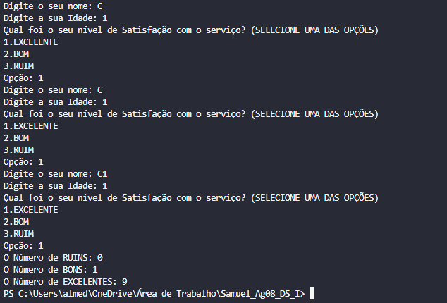

# Sistema de Avalição ao Cliente
👋 Este Sistema têm como finalidade exibir a satisfação do cliente conforme a seleção definida em 3 opções, sendo contabilizado a quantidade individual de cada opção.


## ❓️ Como funciona esse código
1. O usuário insere nas variavéis de mesmo nome, seu nome e a idade pelo terminal.

2. Em seguida aparece um texto solicitadno que ele escolha uma das 3 opções digitando o número.

```
> 1.Excelente  
> 2.Bom  
> 3.Ruim 
```
3. Entra nos laços de decisão que verificam a escolha do usuário comparando com a váriavel um número com a váriavel "sat", e quando encontrar irá incrementar + 1 no contador correspondente a opção.

4. Caso, o usuário insira uma opção inválida, aparece um texto e volta para o início do laço para ele inserir os dados novamente.

5. Ao final do laço é decrementado um candidato conforme o preenchimento correto dos campos, até a condição do while se satisfazer.

5. Ao final do programa, é exibido a quantidade de pessoas que selecionaram determinada opção. 

## ⚙️ Pré-requisitos
Antes de instalar, certifique-se de ter instalado um **ambiente de desenvolvimento (ex. Vscode), extensões essenciais de manipulação/manipulação de [Python](https://www.python.org/) e extensões [Git](https://git-scm.com).**

## 🚀 Instalação e Execução
Para executar e instalar o código/programa, existem duas possibilidades clonando diretamente do repositório no github para IDE ou baixando o arquivo diretamente do github e executando na IDE.

### 1. Usando o terminal para clonar
```
// Clone este repositório pelo terminal 
$ git clone https://github.com/almedasamuel0-stack/Agenda05_DS
```
```
// Abra a pasta onde se encontra o código principal
$ cd projetos/consumo-energia
```
```
// Execute o código
```
---

### 2. Baixando os Arquivos
  * Acesse a página principal do repositório no github;
  * Clique no *botão verde _CODE_*, localizado no lado direito, acima da lista de arquivos;
  * No menu suspenso, selecione a opção _Download ZIP_
  * Salve o arquivo e extraia a pasta para acessar todos os arquivosdo projeto. 

---
### 3. Exemplo de execução

<div align="center">
    
    <p><strong>Exemplo de execução </strong></p>
</div>

---